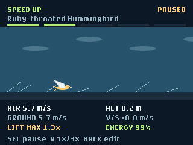

# Bird Flight Lab

Bird Flight Lab explores how bird size, wings and muscle power affect takeoff, speed, soaring, diving and landing.



## Usage

Open **Bird Flight Lab** from the badge menu.

| Screen | Controls |
| --- | --- |
| Selections | Up/Down chooses a row; Left/Right changes it; Select starts flight. |
| Flight | Select pauses/resumes; Right switches 1x/3x playback; Back returns to selections. |
| Report | Select replays the same bird; Back changes selections. |
| Anywhere | Home returns to the launcher. |

Choose from 12 Otter Tail County, Minnesota bird presets, then adjust body
mass, full wingspan, wing shape, mechanical muscle power, wind and thermal
updraft. The app starts with Mallard. The first row shows the full bird name;
the counter above it shows your position in the dozen. Left/Right wraps
around the list.
Changing the preset resets mass, wings and power to that bird's defaults,
and wind/thermal to calm. Selections remain while editing/replaying but are
not saved when leaving the app. No network, credentials or extra hardware
are required.

## Otter Tail bird presets

The original generic Sparrow, Pigeon, Eagle and nonlocal Albatross presets
are replaced by this local-interest dozen, including a specifically named
Bald Eagle. These birds cover lakes, wetlands, farms, forests and gardens.

| Bird | Mass | Full wingspan | Model wing shape | Model power |
| --- | --- | --- | --- | --- |
| Peregrine Falcon | 900 g | 1.05 m | Tapered | 180 W/kg |
| Common Loon | 4.5 kg | 1.30 m | Tapered | 180 W/kg |
| Barn Swallow | 19 g | 0.31 m | Slender | 130 W/kg |
| Ring-necked Pheasant | 1.2 kg | 0.75 m | Broad | 180 W/kg |
| Green Heron | 240 g | 0.66 m | Broad | 90 W/kg |
| Bald Eagle | 4.5 kg | 2.10 m | Broad | 90 W/kg |
| Red-tailed Hawk | 1.1 kg | 1.25 m | Broad | 90 W/kg |
| Mallard | 1.1 kg | 0.90 m | Tapered | 130 W/kg |
| Canada Goose | 4.0 kg | 1.60 m | Tapered | 90 W/kg |
| Ruby-throated Hummingbird | 3.2 g | 0.10 m | Tapered | 180 W/kg |
| Belted Kingfisher | 150 g | 0.55 m | Tapered | 130 W/kg |
| Pileated Woodpecker | 300 g | 0.72 m | Broad | 130 W/kg |

All 12 appear on [Cornell eBird's Otter Tail County bird list](https://ebird.org/region/US-MN-111/bird-list).
This establishes reported county occurrence, **not equal abundance,
year-round presence or a guarantee of seeing each bird**. The requested
Peregrine is included as a special-interest bird, not a claim that it is
as routinely encountered as a Mallard.

Masses and spans are rounded representative starting estimates, not precise
species averages. Cornell's All About Birds identification guides were
accessible for [Barn Swallow](https://www.allaboutbirds.org/guide/Barn_Swallow/id)
(17-20 g, 29-32 cm span), [Green Heron](https://www.allaboutbirds.org/guide/Green_Heron/id)
(240 g, 64-68 cm), and [Ring-necked Pheasant](https://www.allaboutbirds.org/guide/Ring-necked_Pheasant/id/)
(500-3000 g, 56-86 cm). The other nine guides blocked automated retrieval;
their preset sizes are illustrative estimates, not independently verified
Cornell measurements. Wing categories and power levels for **all** birds are
model assumptions, not measured species-specific aerodynamics or physiology.

## What you see

The bird automatically attempts **takeoff, acceleration, soaring, a dive and
landing**, in that order. The progress strip shows the current phase. Wings
flap under power, spread during soaring and fold visually during the dive.
The trail and moving ground show its path; green arrows indicate rising air.
All readings use simulated time, independent of playback speed.

The flight screen shows airspeed and signed ground speed in m/s, altitude
and vertical speed, maximum available lift divided by body weight, and
remaining energy. A lift reading below 1 means the wings cannot support the
bird's weight at that airspeed. Stalls, failed takeoffs and hard landings are
possible, rather than every selection receiving the same animation.
The report compares takeoff distance, peak airspeed/altitude, height gained
or lost during soaring, energy reserve and elapsed time.

Try these comparisons, changing one selection at a time:

- Increase mass or shorten wings: stall speed increases and takeoff gets harder.
- Add headwind: less ground run is needed to reach flying airspeed.
- Try slender wings: lower profile drag helps gliding, but maximum lift is lower.
- Add a 3 m/s thermal: the unpowered soaring phase can gain height.
- Combine double mass, short slender wings and 35 W/kg power: takeoff can fail.

## Educational model and limitations

This is a qualitative, two-dimensional flight experiment, **not validated
biological data, a species-performance predictor, or an engineering tool**.
Presets are representative starting sizes, not measurements of individual
birds. Adjustable combinations can be anatomically impossible.

`flight.py` uses SI units, gravity of 9.81 m/s2 and sea-level air density
of 1.225 kg/m3. Wing area is span squared divided by aspect ratio; broad,
tapered and slender wings use aspect ratios 5, 7 and 11. Stall speed follows
the lift equation using body weight, area and maximum lift coefficient.
Drag combines profile drag and induced drag with efficiency 0.8; muscle
power becomes thrust power at a fixed 72% efficiency.

A guided controller trades available power, drag and gravitational energy
for airspeed and climb. Soaring uses no muscle power and sinks according
to drag power divided by weight unless the thermal offsets that sink.
Diving uses gravitational potential energy to gain speed. A landing
controller adds drag and aims to flare near 1.12 times stall speed.
The displayed lift is **maximum support capacity**, not actual lift force.
Energy is a simple 20 kJ/kg mechanical-work reserve, not metabolic calories.

Wind is a uniform horizontal air mass: positive wind is a headwind and
negative wind is a tailwind. It changes ground speed and runway length,
not the stall airspeed. Thermals are uniform rising air, not localized
columns. Takeoff is limited to 120 m or 12 seconds; acceleration and soaring
last 10 seconds each; the dive lasts up to 4 seconds and ends early near
the ground. Landing has a 90-second safety limit. Low altitude or depleted
energy can shorten the sequence.

The model omits 3D turns, turbulence, detailed feather aerodynamics,
wingbeat mechanics, realistic launch biomechanics and structural limits
in a dive. All species use the same guided flight sequence and generic bird
animation. In particular, it does not reproduce loon water takeoff, hummingbird
hovering, pheasant burst-flight endurance or a Peregrine's full-height hunting
stoop; the displayed speeds are not those species' maximum capabilities.
Animation is schematic, not a scale drawing.

## Validation

From the repository root:

```powershell
python -m unittest discover -s tests -p test_bird_flight_lab.py
python .github\skills\hyb26-skill\scripts\validate_app.py badge\apps\bird_flight_lab
```

In the Badge Simulator, exercise selections, pause/resume, 3x playback,
all five phases, reports, replay, Back, Home/reopen and inverted orientation.
Static and simulator checks do not prove physical-badge compatibility.
Before considering a hardware installation verified, deploy using the
simulator's **Deploy** button, check the custom bird icon in the launcher,
exercise the same controls and phases in both orientations, and test
Home/reopen. No physical deployment is required to use the simulator.
